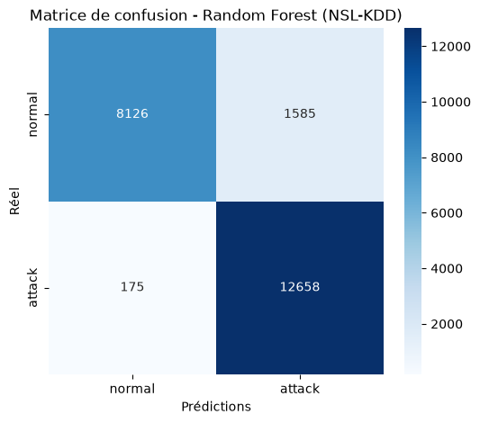
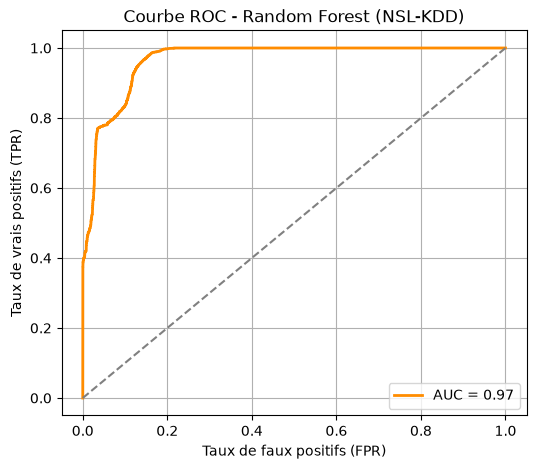
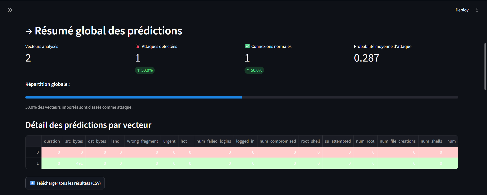
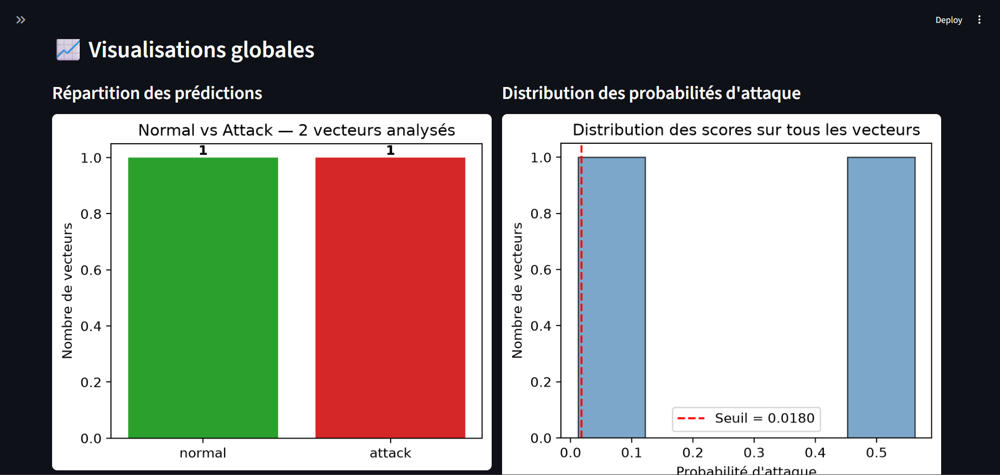

🇫🇷 [Lire en français](README.fr.md)

# Network Intrusion Detection with Machine Learning (NSL-KDD)

A machine learning project that detects malicious network connections. It trains and compares three classifiers (SVM, Random Forest and XGBoost) on the NSL-KDD benchmark dataset, then serves the selected model (Random Forest) through a small Streamlit web interface where you can upload network traffic records and get a prediction for each one.

The work started as an end-of-studies project (Licence in Computer Science, Faculty of Sciences, Rabat) and is shared here as a complete, runnable example of an ML pipeline: data preparation, model comparison, model export, and a simple application on top of it.

## What the project does

- Cleans and prepares the NSL-KDD data (binary labels, one-hot encoding, column alignment between train and test).
- Trains three models on the same data and evaluates them on the official test set with the same metrics.
- Chooses a decision threshold for each model from its precision-recall curve instead of using the default 0.5.
- Saves the final Random Forest model, its expected columns and its threshold to disk.
- Provides a Streamlit app that loads these files and classifies uploaded CSV files as `normal` or `attack`.

## Dataset

[NSL-KDD](https://www.kaggle.com/datasets/hassan06/nslkdd) is a cleaned-up version of the KDD Cup 99 dataset, widely used to evaluate intrusion detection systems. Each row describes one network connection with 41 features (duration, protocol, service, bytes transferred, error rates, and so on).

| File | Rows | Role |
| --- | --- | --- |
| `KDDTrain.csv` | 125,973 | Training |
| `KDDTest.csv` | 22,544 | Testing |

The original labels (normal, DoS, Probe, R2L, U2R) are grouped into two classes: `normal` and `attack`. The three categorical features (`protocol_type`, `service`, `flag`) are one-hot encoded, which gives **122 input columns**. The official train/test split is kept as is, with no random re-split.

## Results

All figures below are measured on the 22,544 connections of `KDDTest.csv`, at each model's chosen threshold. The `attack` class is the positive class.

| Model | Accuracy | Precision (attack) | Recall (attack) | F1 (attack) | AUC |
| --- | --- | --- | --- | --- | --- |
| SVM (RBF kernel) | 87.13 % | 0.91 | 0.86 | 0.88 | 0.904 |
| Random Forest | **92.19 %** | 0.89 | 0.99 | 0.93 | 0.966 |
| XGBoost | 91.46 % | 0.88 | 0.99 | 0.93 | **0.970** |

Random Forest and XGBoost are very close and clearly ahead of the SVM. Random Forest has the best accuracy and slightly fewer false alarms (1,585 against 1,738), while XGBoost has the best AUC. Both miss very few attacks (175 and 187 undetected attacks). Random Forest was kept for the interface.

Random Forest confusion matrix (left) and ROC curve (right):

<p>
  
  
</p>

### Model settings

- **SVM:** `StandardScaler` followed by `SVC` (RBF kernel, `C=1.0`, `gamma='scale'`, `probability=True`).
- **Random Forest:** 500 trees, `max_depth=15`, `min_samples_split=10`, `min_samples_leaf=4`, `max_features='sqrt'`.
- **XGBoost:** 500 trees, `max_depth=8`, `learning_rate=0.05`, `subsample=0.8`, `colsample_bytree=0.8`, `reg_alpha=0.1`, `reg_lambda=1.0`.

## The web interface

The app (`notebooks/app_v1.py`) lets you:

- upload a CSV file with one or several network records;
- adjust the decision threshold with a slider in the sidebar (the default is the one saved by the notebook);
- see a global summary (number of records, attacks detected, normal connections, mean attack probability);
- browse a table where each row is colored by its prediction, and download the results as CSV;
- view three charts: counts per class, distribution of attack probabilities with the threshold, and a pie chart of the split;
- if the file contains a `class` column, compare the predictions with the true labels.





**Input format.** The app expects a file that is **already preprocessed**: the 122 columns obtained after one-hot encoding, in the same format as `X_train` / `X_test` in the notebook. Missing columns trigger a warning, and extra columns are ignored. Ready-to-use examples are provided in the repository:

- `notebooks/deux_lignes.csv`: two records, one normal and one attack;
- `notebooks/ligne_attack_nslkdd.csv` and `notebooks/ligne_normal_nslkdd_corrige.csv`: one record each;
- `APP_data_test/`: further test files, including `test_ready_for_interface.csv`.

## Project structure

```
.
├── notebooks/
│   ├── machine_learning_project.ipynb   # data prep, training, evaluation, model export
│   ├── app_v1.py                        # Streamlit interface
│   ├── KDDTrain.csv / KDDTest.csv       # NSL-KDD data
│   ├── rf_model.pkl                     # trained Random Forest
│   ├── rf_columns.pkl                   # the 122 columns expected by the model
│   ├── rf_threshold.pkl                 # decision threshold
│   ├── deux_lignes.csv, ligne_*.csv     # small sample inputs for the app
│   └── req1.txt                         # Python dependencies
├── APP_data_test/                       # extra test files for the interface
├── data/                                # original NSL-KDD files
├── screenshots/                         # images used in this README
└── .gitignore
```

## Getting started

### 1. Install

You need Python 3.10 or newer.

```bash
git clone https://github.com/salmahanabal/IDS-ML---PFE-Licence.git
cd IDS-ML---PFE-Licence

python -m venv .venv
# Windows (PowerShell):  .venv\Scripts\Activate.ps1
# macOS / Linux:         source .venv/bin/activate

pip install -r notebooks/req1.txt
pip install streamlit
```

### 2. Run the interface

The trained model files are already in the repository, so you can launch the app right away:

```bash
streamlit run notebooks/app_v1.py
```

Then open the address shown in the terminal (usually http://localhost:8501) and upload one of the sample CSV files.

### 3. Reproduce the training

Open `notebooks/machine_learning_project.ipynb` in Jupyter or VS Code and run the cells from top to bottom, once. The notebook reads `KDDTrain.csv` and `KDDTest.csv` from its own folder and rewrites the three `rf_*.pkl` files at the end of the Random Forest cell. Training can be slow, especially the SVM with probability estimates and the cross-validated learning curves, so expect it to take a while on a laptop.

## Limitations

- The decision threshold of each model is chosen from the precision-recall curve computed on the test set, which is also the set used to report the metrics. The reported scores are therefore somewhat optimistic; a fairer protocol would pick the threshold on a validation split.
- The task is binary (`normal` or `attack`). It does not say which type of attack was detected.
- NSL-KDD is a 2009 benchmark. It is useful for comparing methods, but it does not reflect modern network traffic.
- The interface needs preprocessed input and is not connected to live network traffic.

## Ideas for improvement

- Multi-class classification to identify the type of attack (DoS, Probe, R2L, U2R), which needs a strategy for the rare classes.
- Evaluating the models on a more recent dataset such as CICIDS2017.
- Putting the preprocessing inside the app so that raw NSL-KDD files can be uploaded directly.
- Real-time detection on captured network flows.

## Tech stack

Python, pandas, NumPy, scikit-learn, XGBoost, matplotlib, seaborn, joblib, Streamlit, Jupyter.
